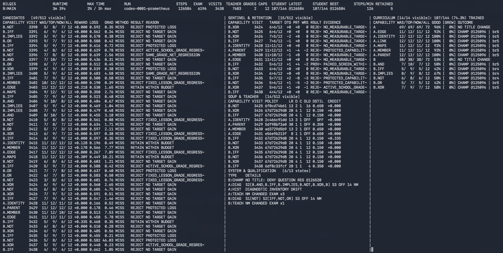

# Bilqis MLX

Private, source-oracled MLX training for a compositional semantic transformer. **This is the one active repository:** `~/Code/bilqis-mlx`. The human operator alone launches real neural updates; CI, tests, and agents must not train or replace the human student.

The former Bilqis implementations are preserved as pinned, read-only source dependencies under `vendor/legacy-v16/`. They are not separate runtime repositories. The native historical bootstrap checkpoint and inherited teacher state live in the ignored `vendor/legacy-v16/runs/`. The current model, its matching AdamW, learning history, champions and soups live under ignored `runs/`. None of those binaries are committed to Git.

## Live training cockpit



*A live Bilqis training run in the operator dashboard. The cockpit summarizes runtime and whole-student progress while the panes expose candidate retention, sentinel and teacher evidence, qualification state, and curriculum mastery at a glance.*

## Keep training the existing student

**Curriculum factory authority:** [`SPEC-0001`](docs/specifications/0001_GENERATIVE_CURRICULUM_FACTORY.md) defines the mandatory end state for semantics-to-grade compilation, release, admission, assessment, generalization, repository structure and extension. The production rule is **no factory release, no grade**. New grades are declarative factory instances; handwritten grade-specific runtime paths are nonconforming. The execution packet is [`TASK-0001`](docs/tasks/0001_IMPLEMENT_GENERATIVE_CURRICULUM_FACTORY.md).

**Championship authority:** [Championship lifecycle specification](docs/specifications/0002_CHAMPIONSHIP_LIFECYCLE_V1.md) governs curriculum-boundary resets, capability champions, grade-wide takeover and frozen soup eligibility. Normal examinations establish earned capability roles before graduation, including on fresh runs. Flash continues to defer title qualification.

```bash
cd ~/Code/bilqis-mlx
npm run train -- --dry-run --resume --verify-source
npm run train -- --human-run --resume --minutes 90
```

The first command is **read-only** and reports blockers. Only the second, explicitly run by the human, makes neural updates. Both use the default `runs/school-mlx-v1` and the internal historical oracle files. No `--legacy-code-root` flag, another checkout or checkpoint clone is needed. The actual progress and optimizer step always come from the latest `runs/school-mlx-v1/state.json`, not from dated documentation.

## Resume the isolated issue #340 experiment

The issue #340 trial is isolated under `~/Code/bilqis-mlx-retention-lab`. Its protected historical recovery baseline remains `bundles/best-8355-a03fa6317bd4` (SHA `cda606f9...`, native AdamW step 230184, old cohort evidence 287/291), but the **current continuing causal student is now step 230200**, SHA `c714ef49...`, after one retained C.DIV update. The canonical `~/Code/bilqis-mlx/runs/school-mlx-v1/` bundle remains read-only evidence and is never used as the live pointer. The current scheduler is ordered Grade-C prefix revalidation at **Grade A RECOVERY_1**. The evolved experimental teacher and matching native AdamW are retained.

The championship epoch began empty at the explicit baseline rebase, but it is no longer empty: later intact source-scored evidence has earned 19 active capability-best roles and frozen A/B/C soup votes. The rebased baseline itself still has zero automatic teaching votes. Commit `a041b01` restores fresh source-oracled routine examinations at every MAIN/RECOVERY boundary while keeping promotion/graduation attempts separate, repairs S3 across explicit rebase lineages and fresh paired cohorts, and activates per-human-command stagnation containment without waiving graduation debt. Historical cohorts, champions, soups and checkpoint receipts remain immutable evidence; old fixed-cohort scores must not be treated as directly comparable to newly drawn routine cohorts.

When that containment exhausts all healthy work and every remaining quarantined mastery debt belongs to one grade, the trainer enters an explicit sole-grade rehabilitation pass instead of stopping only to repeat the same recovery pattern on the next command. It re-admits only the recorded debt capabilities; no debt is passed, forgiven or assigned a synthetic score, and fixed-frontier preservation remains in force. Exams sampled while debt was withheld remain partial evidence for championship authority even if rehabilitation begins after scoring. Mixed-grade deferred debt still stops for review under the existing behavior.

For the current issue #340 B recovery, repeated stagnation containment is itself obstructing rehabilitation after the long misinformed-teacher period. The next **human-owned** resume may therefore activate a persisted B-only grace window for 100,000 retained optimizer steps. During that window the system still detects and records stagnation, but does not quarantine B; all retention/preservation and mastery rules remain active, and other grades keep normal containment. The first command that creates the lease uses `--stagnation-grace-grade B --stagnation-grace-steps 100000`; later resumes inherit the recorded absolute deadline and must not reset it merely by omitting or repeating the options.

```bash
cd ~/Code/bilqis-mlx-retention-lab
npm run train -- --dry-run --resume --verify-source --run-dir ./runs/issue-340-mentor-epoch-trial
npm run train -- --human-run --resume --minutes 15 --run-dir ./runs/issue-340-mentor-epoch-trial
```

The baseline rebase is already complete and receipted; do **not** rerun it before the next trial. The human alone starts the **last** command after the dry-run reports no blockers. As of 2026-10-18 04:30 EDT, the exact dry-run above reports `blockers: []` and performs no neural updates. The next trial tests fresh-cycle learning, paired S3 retention evidence, subperfect championship guidance, and automatic temporary containment of repeatedly failed recovery capabilities while preserving the exact student+own-AdamW lineage. Preserve both original and experimental runs.

**Retention is the default for every training launch and resume.** The former `--experimental-retention` opt-in is no longer needed (older commands remain accepted for compatibility). Existing protected student/AdamW lineages keep their recorded policy and cannot be resumed without retention. To deliberately run the older, unprotected teaching path for an **independent** experiment, supply `--no-retention` with a distinct explicit `--run-dir`; this cannot turn off protection for `runs/school-mlx-v1/`. An opt-out is never inferred from an omitted flag. Retention rejects locally non-improving candidates and preserves matching AdamW; whole-student regressions can still occur.

```bash
npm run status
npm run dashboard
npm run diagnostics -- --run-dir ./runs/school-mlx-v1
```

**Candidate retention net-grade correction (ADR-054):** A target gain never justifies a larger within-grade loss. Every admitted capability in that grade is checked on a complete equal-size fresh paired panel, which must improve strictly in aggregate. When the current grade has a saved matching whole-grade exam cohort, its fixed score must not regress either. For example, B.XOR +1 versus B.IFF -1 and B.IMPLIES -1 is a rejection, not a retained improvement. See docs/specifications/0003_CANDIDATE_RETENTION_GRADE_NET_V1.md. No previous student optimizer steps are rolled back by this prospective rule.

**Staged scoring refinement (ADR-055/057):** Check the candidate's target first and reject immediately if it makes no gain. Fill only still-missing fresh capabilities in its lesson grade next. Before a complete fixed school frontier exists, keep the original stricter positive-grade/protected-item guards. Once a complete fixed frontier exists, late-stage retention becomes aggregate: the fresh lesson grade, fixed lesson grade, active school grade and whole-school fixed total may tie but must not regress; individual rows/capabilities may trade errors. The saved frontier must belong to the exact current retained parent SHA and native AdamW step; stale-parent frontier evidence fails closed. Protected and OR/XOR item regressions remain diagnostics rather than late-stage vetoes. Champion scoring is separate and unchanged.

The source-backed Grade C staircase teaches established counting, number, successor, addition and subtraction operations on gradually expanded domains before introducing multiplication and division. New semantics enter an append-only native registry. The vocabulary size is graph-bound, not permanently 222 tokens. A/B retention is assessed on the same whole student; individual best champions and frozen grade soups remain distinct from live student promotion.

**Capability championships (ADR-018/058/068):** A complete relevant-grade exam establishes individual champions before graduation. A weaker retest preserves the incumbent's role and votes. A contender competes against its current score on identical questions; equal-max ties use greater perfect breadth within that grade, then full-grade perfection plus strict whole-school victory from any origin. Every external winner must also answer all saved earning questions inherited from every displaced champion and ancestor. These source-bound obligations follow the checkpoint across its roles, including foreign-grade and whole-school evidence. Historical max-question proof preserves direct votes; it does not freeze the live student's scores.

**Cross-grade specialist voting (ADR-062):** Every active maxed capability role contributes one direct source-gold-agreeing confidence vote to lessons in any admitted grade. A shared checkpoint is inferred once but counts once per qualifying role. Non-max roles stay direct-silent. Frozen grade soups remain a separate aggregate adviser: full base votes in their own grade, base votes divided by the number of admitted grades elsewhere. With current A/B/C, six maxed A roles give B six direct votes and A's six-vote soup adds two more.

**Three-lane source preparation (ADR-063):** Protected human training now defaults to two spawned host-side source-preparation workers plus the one sovereign MLX/student/AdamW lane. The workers may generate deterministic future lesson material but never receive model parameters, optimizer state, writable run state or championship authority; all neural inference/training, retention, teacher credit, scheduling, exams and persistence remain serialized on the main lane. Use `--source-prefetch-workers 0` for the exact serial control path. The starter release intentionally caps this option at two workers; it is not parallel MLX training.

**Fresh ternary fallback (ADR-064):** If the human judges the current FP32 recovery to have failed to produce meaningful growth, the next major experiment is a new ternary model trained from scratch, not another checkpoint rescue or post-training conversion. The first comparison keeps the current six-layer, width-384 topology and source/curriculum/evaluation contract fixed while changing the neural weight representation. The FP32 lineage remains immutable evidence; ternary gets its own run, optimizer, initialization, quantizer/export receipts and exact hashable ternary codes.

**Binary lesson structural coverage (ADR-065):** Grade-B optimizer batches now keep every source-valid operand truth pattern for the active connective represented before old-grade rehearsal can consume the remaining lesson capacity. The compositional A/C bridge also targets the connective currently being taught, including unary NOT, instead of spending adjunct examples on unrelated B operators. This changes lesson construction only; gold, exams, scheduler, retention and student/AdamW custody are unchanged.

The retention-aware teacher tests parent-versus-challenger changes and preserves recoverable best whole-student checkpoints with **their own AdamW**. **Only a strictly positive, source-oracled gain in the targeted capability can promote a candidate.** Rejected attempts still teach both the contextual teacher **and the inherited strategy-selection bandit**, using the measured causal rejection penalty rather than incorrectly reporting zero reward to the bandit. Rejection does not change the student or AdamW; recorded instructional accuracy and historical teacher rewards retain their original meanings. Graduated A/B capabilities retain mature protection in every C scheduling phase. The active probe has a bounded size informed by that skill's current exam count, while cross-grade protection probes stay small. This provisional gate is neither perfect retention nor a graduation shortcut. Temporary forgetting remains possible. The whole student always advances from its latest committed checkpoint unless the human explicitly directs recovery.

When a comparable full-school examination includes B.OR and B.XOR, candidate screening also replays their 24 source-oracled, truth-balanced fixed-cohort questions. Any newly wrong answer on these already-correct compositions rejects the trial, without evaluating all school capabilities. Teacher feedback still records the rejection. The dashboard's **LESSON%** column measures fresh instructional examples; cumulative qualification is reported separately under **GRADES & MASTERY**.

**Post-stall preservation and exam reuse (ADR-056/057):** The zero-retention run showed concentrated OR/XOR interference, so protected lessons rehearse fresh source-oracled structural siblings while excluding fixed exam identities. Exact structural matches are preferred, with graceful fallbacks rather than blocking training. The later human run proved that per-item monotonicity is also wrong for mature learning: individual mistakes may move as long as the late-stage lesson grade, active school grade and whole school do not regress. Scheduled whole-school exams on an unchanged retained checkpoint can still reuse a fully verified prior score/miss result.

Longitudinal learning diagnostics must examine **distinct student checkpoints**, not count re-examinations of the same unchanged checkpoint as new learning. Repeated exams remain individually source-verified and present in the audit; genuinely changed or backward checkpoint identities still fail closed. The School50 diagnostic display must expose a history-validation failure instead of silently presenting an unavailable durability signal as “no active warnings.”

Recovery ranks the complete cumulative pool of introduced and graduated capabilities. Perfect capabilities must not pad a weakest-three recovery round. The normal teaching pass should avoid an unnecessary optimizer trial when the current student is already perfect on a fresh source-oracled target probe; whole-student examinations still recheck every admitted capability. The experimental matrix-strain signal compares parent-to-candidate weight movement against an immutable curriculum-epoch starting checkpoint and the best **comparable whole-student** high-water checkpoint. That high reference advances only on a strictly higher cumulative score recorded by the whole-student peak authority, never on ties or grade-soup refreshes. Matrix-strain diagnostics are advisory, not an automatic retention veto or replacement for examinations.

## Repository layout

| Path | Ownership |
| --- | --- |
| `bilqis_mlx/` | Active semantic engine, MLX teacher/student, training, runtime, checks and School50 telemetry |
| `vendor/legacy-v16/` | Frozen historical source oracles and teacher implementation; no new feature development |
| `vendor/legacy-v16/runs/` | Ignored original historical bootstrap checkpoint and teacher-state provenance |
| `runs/school-mlx-v1/` | Ignored active human student and its saved optimizer, source/oracle receipts and teacher history |
| `runs/archive/` | Ignored historical local safety copies pending independent external backup |
| `docs/` | Current operator contracts and historical/research records |
| `tests/` | Disposable, source-verified fixtures; no actual-student optimizer writes |
| `.github/workflows/` | Portable integrity checks and private release automation |

`BILQIS_STORAGE_ROOT` configures the default local run home. The retention trainer requires that home to remain inside this repository's `runs/` tree; its current fully tested default is `runs/school-mlx-v1/`. Store backups on a distinct, explicitly selected volume and verify them before deleting any original checkpoint; moving files between folders on the same volume does not free space.

## Checkpoint and disk maintenance

Full student and matching optimizer checkpoints are kept together. A saved state is immutable, and source-cohort graduation tests never combine best scores from different students. Routine checkpoint retirement only removes genuinely unreferenced bundle directories after commit. Unexpected files and symlinks fail closed; harmless macOS Finder metadata no longer blocks resume. Protected champions, live state, accepted whole-student peaks, frozen soup recipes and qualified sources retain explicit identity.

```bash
npm run storage:plan
# Optional, when training is inactive: losslessly compress older immutable JSON states
npm run storage:compact -- --max-files 0
```

The normal human-run stop path also performs bounded lossless compression of old state JSON. It does not delete neural weights, AdamW, original authority records or checkpoints held by a live role. See [checkpoint and release migration](docs/operations/CANONICAL_REPOSITORY_AND_RELEASE_20261017.md) for custody details. No backup script runs automatically against arbitrary external drives.

## Development and release

```bash
python3 -B -m unittest discover -s tests -q     # Apple Silicon/MLX integration suite
npm run quality:check
npm run release:check
python3 -B scripts/check_historical_abi.py
python3 -B scripts/check_semantic_boundaries.py
```

The portable Linux GitHub Actions jobs verify source, semantic ABI, release manifests, selected neural-inert tests and regression-aware code hygiene. Full neural testing is Apple Silicon only. Conventional Commits, Semantic Versioning and a dated `CHANGELOG.md` govern private releases. Tag an immutable annotated `vMAJOR.MINOR.PATCH` on a verified clean `main`; the tag workflow validates and publishes private release notes. See [contribution and release rules](CONTRIBUTING.md).

For detailed historical decision-making and source provenance, read [ADR.md](ADR.md), [AGENTS.md](AGENTS.md) and the [archived pre-consolidation README](docs/history/README_PRE_CANONICAL_20261017.md). Historical example paths in old research papers are **provenance**, not current operator commands. Protected research contracts must not be copied into public repositories.
